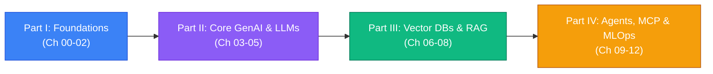

# AI Engineering: Zero to Hero

Welcome to **AI Engineering: Zero to Hero** — a comprehensive, production-grade curriculum designed to take builders from foundational Python and mathematical intuition through to modern LLMs, Production RAG architectures, Autonomous Agents, and the Model Context Protocol (MCP).

## Curriculum Breakdown & Core Pillars

### Part I: Foundations
- **Chapter 00: Builder Launchpad** — Python for AI, OOP, REST APIs, Git/GitHub, Linux CLI essentials.
- **Chapter 01: Math & Stats Intuition** — Vectors, Dot Products, Cosine Similarity, Gradients, Probability & Bayes Theorem.
- **Chapter 02: Classical ML Bridge** — Supervised/Unsupervised Learning, Loss Curves, Regularization, Cross-Validation.

### Part II: Core Generative AI & Large Language Models
- **Chapter 03: Generative AI Foundations** — GenAI vs Discriminative, Self-Attention, Tokenization, Foundation Models, Fine-tuning, Multimodal, RLHF.
- **Chapter 04: Inside Large Language Models** — Transformer Architecture, BPE, Positional Encoding, KV Cache, LoRA, Quantization, SLMs & Reasoning Models.
- **Chapter 05: Prompt & Context Engineering** — Prompt Anatomy, CoT, Delimiters, Structured JSON, Guardrails, ReAct, Prompt Injections.

### Part III: Vector Databases, Data Engineering & Production RAG
- **Chapter 06: Vector Databases & Search** — Embeddings, HNSW, IVF, Product Quantization, Metadata Filtering, Hybrid Search, pgvector, Qdrant, Chroma, FAISS.
- **Chapter 07: Data Engineering for AI** — Data APIs, ETL/ELT, Cleaning, SQL/NoSQL, Streaming, Feature Stores, DVC.
- **Chapter 08: Production RAG Systems** — Document Chunking, Hybrid BM25, Cross-Encoder Re-ranking, Context Management, Citations, Multi-hop, GraphRAG, RAG Triad Evals.

### Part IV: Autonomous Agents, MCP & Production MLOps
- **Chapter 09: Autonomous AI Agents** — ReAct loop, Tool Calling, Planning, Memory, Reflection, Multi-Agent Orchestrator-Worker, LangGraph, Human-in-the-Loop.
- **Chapter 10: Model Context Protocol (MCP)** — N×M problem, JSON-RPC, Tools, Resources, Prompts, Sampling, Server creation, MCP Inspector.
- **Chapter 11: Production Systems & MLOps** — Microservices, Redis Caching, Celery Queues, vLLM/FastAPI serving, Docker, GitHub Actions, Prometheus/Grafana.
- **Chapter 12: Evals, Observability & Safety** — Ragas/DeepEval, Prompt A/B testing, Hallucination Detection, OpenTelemetry, Privacy & Fairness.

Every chapter is a fully executable, interactive notebook containing architectural diagrams, practical code with CPU/mock fallbacks, hands-on capstone labs, and mastery check quizzes.
