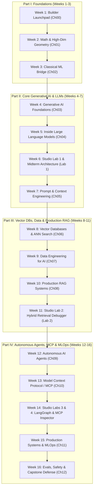

# 16-Week Cohort Syllabus & Capstone Rubric

Welcome to the **AI Engineering: Zero to Hero** 16-Week Intensive Cohort Syllabus. This curriculum guides engineers from core foundations to shipping production-grade, distributed AI systems.

---

## 📅 16-Week Curriculum Roadmap

---

### Detailed Week-by-Week Breakdown

#### **Week 1: The Builder Launchpad**
- **Associated Chapter:** Chapter 00 (`ch00-builder-launchpad.ipynb`)
- **Key Concepts:** Python for AI, Object-Oriented System Modeling, REST APIs with FastAPI, Git branching hygiene, Linux CLI toolchains.
- **Hands-on Deliverable:** Build a verified local development environment with zero Docker/paid API dependencies and implement a typed REST service with SQLite persistence.
- **Colab Notebook:** 

#### **Week 2: Mathematical Intuition & High-Dimensional Geometry**
- **Associated Chapter:** Chapter 01 (`ch01-math-and-stats-intuition.ipynb`)
- **Key Concepts:** Linear Algebra for embeddings, Dot Products, Cosine Distance, Gradient Descent backprop intuition, Probability distributions, Bayes' Theorem.
- **Hands-on Deliverable:** Implement custom vector similarity metrics from scratch in pure NumPy and verify numerical stability.
- **Colab Notebook:** 

#### **Week 3: The Classical Machine Learning Bridge**
- **Associated Chapter:** Chapter 02 (`ch02-classical-ml-bridge.ipynb`)
- **Key Concepts:** Supervised vs Unsupervised learning, Loss curves, Bias-Variance tradeoff, L1/L2 Regularization, Cross-validation strategies.
- **Hands-on Deliverable:** Train, evaluate, and benchmark a classical tabular model with scikit-learn; profile training loss convergence.
- **Colab Notebook:** 

#### **Week 4: Generative AI Foundations**
- **Associated Chapter:** Chapter 03 (`ch03-generative-ai-foundations.ipynb`)
- **Key Concepts:** Generative vs Discriminative modeling, Self-Attention mechanism, Transformer encoders/decoders, Tokenization, Foundation Models, Pre-training vs Fine-tuning, RLHF, AI Safety basics.
- **Hands-on Deliverable:** Implement a minimal PyTorch multi-head self-attention module and inspect attention weight matrices.
- **Colab Notebook:** 

#### **Week 5: Inside Large Language Models**
- **Associated Chapter:** Chapter 04 (`ch04-inside-large-language-models.ipynb`)
- **Key Concepts:** Byte-Pair Encoding (BPE), Rotary Positional Embeddings (RoPE), KV Caching, LoRA parameter-efficient tuning, Post-training Quantization (AWQ/GGUF), Reasoning models.
- **Hands-on Deliverable:** Profile KV cache memory consumption across sequence lengths and quantify quantization perplexity trade-offs.
- **Colab Notebook:** 

#### **Week 6: Tokenizer & Embedding Mechanics (Studio Lab 1)**
- **Associated Studio Lab:** Split-Screen AI Engineering Studio — Tab 1
- **Key Concepts:** Token boundary effects, Subword vocabularies, Semantic vector clustering, PCA / t-SNE 2D projections.
- **Hands-on Deliverable:** Run interactive tokenization scans and explore cosine similarity geometry directly in the companion studio UI.

#### **Week 7: Prompt & Context Engineering**
- **Associated Chapter:** Chapter 05 (`ch05-prompt-and-context-engineering.ipynb`)
- **Key Concepts:** Prompt anatomy, Zero-shot & Few-shot conditioning, Chain-of-Thought (CoT), Output schemas (Pydantic / JSON Mode), Guardrails, Prompt injection mitigations.
- **Hands-on Deliverable:** Construct a resilient prompt pipeline with defensive sanitization and automated schema validation.
- **Colab Notebook:** 

#### **Week 8: Vector Databases & Similarity Search**
- **Associated Chapter:** Chapter 06 (`ch06-vector-databases-and-search.ipynb`)
- **Key Concepts:** Approximate Nearest Neighbor (ANN) search, Hierarchical Navigable Small World (HNSW) graphs, Inverted File (IVF), Product Quantization (PQ), pgvector & Qdrant architectures.
- **Hands-on Deliverable:** Benchmark recall vs QPS latency curves across index types using local pgvector and ChromaDB.
- **Colab Notebook:** 

#### **Week 9: Data Engineering for AI Systems**
- **Associated Chapter:** Chapter 07 (`ch07-data-engineering-for-ai.ipynb`)
- **Key Concepts:** Document ingestion ETL/ELT pipelines, OCR and layout parsing, Chunk deduplication, Feature stores, Streaming pipelines with Kafka/Redis, Data versioning with DVC.
- **Hands-on Deliverable:** Implement an idempotent document ingestion pipeline that extracts, normalizes, and versions unstructured PDFs.
- **Colab Notebook:** 

#### **Week 10: Production Retrieval-Augmented Generation (RAG)**
- **Associated Chapter:** Chapter 08 (`ch08-production-rag-systems.ipynb`)
- **Key Concepts:** Chunking strategies, Hybrid Search (Dense + BM25), Reciprocal Rank Fusion (RRF), Cross-Encoder reranking, Context window compression, Grounded citation synthesis.
- **Hands-on Deliverable:** Build an end-to-end production RAG service with hybrid retrieval and verified citation grounding.
- **Colab Notebook:** 

#### **Week 11: RAG Chunking & Hybrid Retrieval Debugger (Studio Lab 2)**
- **Associated Studio Lab:** Split-Screen AI Engineering Studio — Tab 2
- **Key Concepts:** Sliding window chunking, Alpha weighting between dense and sparse scores, RRF k-parameter tuning.
- **Hands-on Deliverable:** Interactively evaluate retrieval precision across ambiguous queries using the live studio debugger.

#### **Week 12: Autonomous AI Agents**
- **Associated Chapter:** Chapter 09 (`ch09-autonomous-ai-agents.ipynb`)
- **Key Concepts:** ReAct (Reason + Act) loop, Tool invocation, Task decomposition, Short-term conversation scratchpads, Long-term episodic memory, Multi-agent orchestrator-worker patterns.
- **Hands-on Deliverable:** Implement an autonomous multi-step research agent with sandboxed python execution and error recovery.
- **Colab Notebook:** 

#### **Week 13: Model Context Protocol (MCP)**
- **Associated Chapter:** Chapter 10 (`ch10-model-context-protocol-mcp.ipynb`)
- **Key Concepts:** Solving the $N \times M$ integration challenge, JSON-RPC 2.0 transport, MCP Host/Client/Server topology, Tools, Resources, Prompts, Capability negotiation.
- **Hands-on Deliverable:** Build and test a compliant MCP Server using the official Python SDK exposing custom enterprise tools and resources.
- **Colab Notebook:** 

#### **Week 14: Agent Graph Workflows & MCP Inspector (Studio Labs 3 & 4)**
- **Associated Studio Labs:** Split-Screen AI Engineering Studio — Tabs 3 & 4
- **Key Concepts:** Cyclical state machines with LangGraph, Human-in-the-loop checkpoint pauses, Live JSON-RPC packet inspection.
- **Hands-on Deliverable:** Visualize multi-agent workflow state transitions and inspect raw MCP JSON-RPC protocol packets in real time.

#### **Week 15: Production Systems & MLOps**
- **Associated Chapter:** Chapter 11 (`ch11-production-systems-and-mlops.ipynb`)
- **Key Concepts:** System design for AI, Semantic caching with Redis, Celery async task workers, High-throughput model serving (vLLM / Ollama), Docker containerization, CI/CD with GitHub Actions.
- **Hands-on Deliverable:** Deploy a multi-container Docker Compose stack featuring backend, caching layer, vector store, and monitoring probes.
- **Colab Notebook:** 

#### **Week 16: Evals, Observability, AI Safety & Capstone Defense**
- **Associated Chapter:** Chapter 12 (`ch12-evals-observability-and-safety.ipynb`)
- **Key Concepts:** RAG Triad evaluation metrics (Faithfulness, Answer Relevance, Context Precision), Automated hallucination detection, OpenTelemetry distributed tracing, Red-teaming and compliance.
- **Hands-on Deliverable:** Capstone Project Submission & Live Peer Defense against the 100-Point Grading Rubric.
- **Colab Notebook:** 

---

## 🏆 100-Point Capstone Project Grading Rubric

The Capstone Project requires engineering a production-ready, full-stack AI system demonstrating autonomous agency, MCP integration, hybrid RAG retrieval, and empirical evaluation.

| Dimension | Points | Core Criteria & Standards |
| :--- | :---: | :--- |
| **1. Architectural Rigor & System Design** | **20 pts** | • Decoupled microservice architecture with clean interface contracts. • Graceful local-first fallback (e.g. SQLite/in-memory when Docker/Postgres offline). • Asynchronous non-blocking I/O with streaming token responses. • Clean containerization via `docker-compose.yml` and environment management. |
| **2. Model Context Protocol (MCP) & Agents** | **20 pts** | • Full implementation of a standard-compliant MCP Server (Tools, Resources, Prompts). • Bidirectional JSON-RPC 2.0 communication over stdio or SSE transport. • Multi-agent orchestration (e.g. LangGraph) with cyclical state management. • Human-in-the-loop review checkpoints for sensitive tool actions. |
| **3. RAG Retrieval Quality & Grounding** | **20 pts** | • Hybrid retrieval combining sparse BM25 and dense semantic ANN embeddings. • Cross-encoder reranking stage with Reciprocal Rank Fusion (RRF). • Context window optimization and strict bracketed citation generation `[1]`. • Measurable reduction in retrieval hallucinations on edge-case queries. |
| **4. Production Engineering & Caching** | **20 pts** | • Multi-tier caching: Exact match + semantic similarity thresholding. • Sub-100ms response times for cached common query patterns. • Idempotent data ingestion pipelines with automated batching. • Comprehensive unit test suite with high branch coverage (`pytest`). |
| **5. Safety, Evals & Observability** | **20 pts** | • Automated RAG Triad evaluation pipeline (Faithfulness, Relevance, Precision). • Real-time OpenTelemetry tracing across all model and tool invocations. • Defensive prompt injection guards, PII sanitization, and output schema assertions. • Complete documentation: Architecture diagrams, setup instructions, and audit log. |
| **Total Score** | **100 pts** | **Minimum Passing Grade for Cohort Certification: 80/100 pts** |
