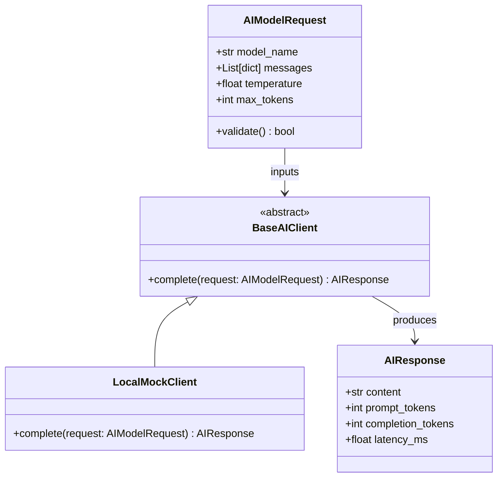

# NotebookLM Study Guide: Chapter 00: Builder Launchpad

**Chapter ID:** `ch00`  
**Part:** Part I: Foundations  
**Target Ingestion:** Google NotebookLM Source (Audio Podcast, Socratic Tutor & Flashcards)

---

## 🎯 Executive Summary & Core Pillars
This chapter covers foundational and production-grade knowledge in modern AI engineering.

### Core Concepts Covered:
- **Python for AI**
- **OOP**
- **REST APIs**
- **Git/GitHub**
- **Linux CLI**

---

## 📖 In-Depth Concept Breakdown

### 1. Python for AI & Modern Object-Oriented Patterns

Modern AI engineering requires robust software engineering practices. We leverage Python's type hints, dataclasses, asynchronous execution, and OOP abstraction to build resilient AI pipelines.

*Architecture Concept Diagram:*

### 2. REST APIs & Client Connectivity

AI systems interact with foundational models through HTTP/REST endpoints. Understanding headers, JSON serialization, status codes, and exponential backoff is essential for reliable integrations.

### 3. Git/GitHub & Linux CLI Foundations

Professional AI engineering requires strict version control, clean atomic commits, reproducible scripts, and mastery of CLI pipes (`grep`, `awk`, `find`, `curl`).

---

## 🛠 Hands-On Capstone Lab Blueprint
- **Title:** Build a Resilient AI Service Client with Exponential Backoff
- **Objective:** Implement an AI Service Client that handles network errors, performs retry attempts with exponential backoff, and tracks usage statistics.
- **Implementation Strategy:**
1. Define a custom exception `APIConnectionError`.
2. Implement a retry mechanism with backoff.
3. Wrap the mock completion method to simulate occasional transient errors and test recovery.

---

## 🎙 Socratic Discussion Questions for NotebookLM Audio Overviews
1. **Trade-off Analysis:** What are the operational latency, memory, and cost implications of the techniques introduced in this chapter?
2. **Production Pitfalls:** Under what conditions do these methods fail (e.g. out-of-memory, prompt injections, catastrophic forgetting, low recall)?
3. **Engineering Synthesis:** How does this chapter connect to downstream systems such as RAG retrieval, agent orchestration, or MCP tooling?

---

## 🗂 Flashcard & Self-Check Review Deck

#### Flashcard 1: What is the primary benefit of using Python dataclasses for AI request/response models?
- **Answer:** A) They eliminate the need to run unit tests
- **Explanation:** Dataclasses automatically generate boilerplate methods such as __init__, __repr__, and __eq__ while providing clear structural schemas for AI payloads.

#### Flashcard 2: When designing an AI client interacting with rate-limited REST endpoints, what retry strategy is recommended?
- **Answer:** A) Immediate infinite retry loops
- **Explanation:** Exponential backoff progressively increases delay between attempts, preventing thundering herds and allowing transient network/rate limits to clear.

#### Flashcard 3: Which Git command creates and switches to a new branch named 'feature/rag' in modern Git?
- **Answer:** A) git switch -c feature/rag
- **Explanation:** 'git switch -c <branch>' (or 'git checkout -b <branch>') creates and checks out the new branch in one command.

#### Flashcard 4: In Linux CLI, which operator pipes the stdout of one command as the stdin of the next?
- **Answer:** A) >
- **Explanation:** The pipe operator '|' connects the standard output of the left command directly into the standard input of the right command.

