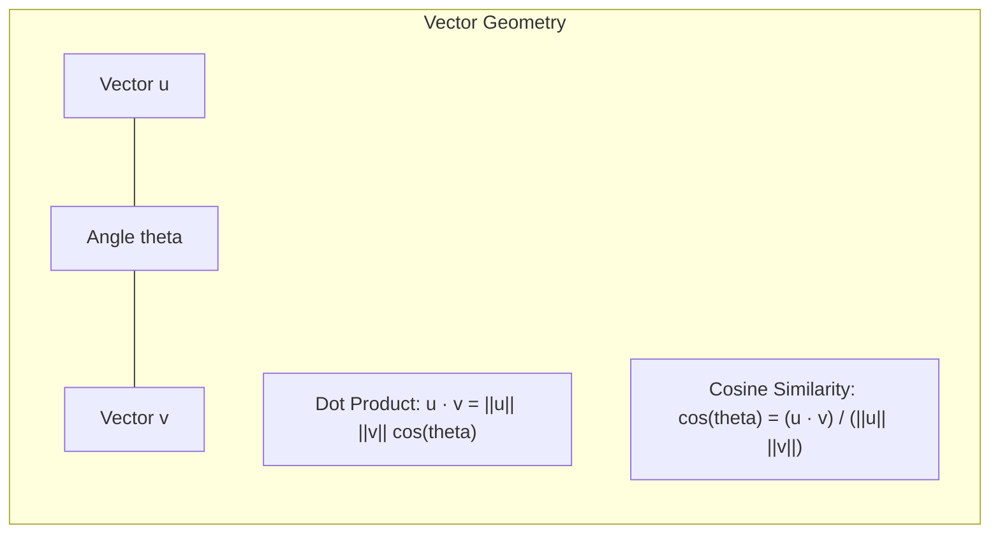

# NotebookLM Study Guide: Chapter 01: Math & Stats Intuition for AI

**Chapter ID:** `ch01`  
**Part:** Part I: Foundations  
**Target Ingestion:** Google NotebookLM Source (Audio Podcast, Socratic Tutor & Flashcards)

---

## 🎯 Executive Summary & Core Pillars
This chapter covers foundational and production-grade knowledge in modern AI engineering.

### Core Concepts Covered:
- **Linear Algebra**
- **Dot Products**
- **Cosine Similarity**
- **Calculus/Gradients**
- **Probability**
- **Bayes Theorem**

---

## 📖 In-Depth Concept Breakdown

### 1. Linear Algebra: Vectors, Norms & Dot Products

Vectors form the mathematical backbone of modern AI embeddings. The dot product measures directional alignment, while vector magnitude (L2 norm) measures vector length.

*Architecture Concept Diagram:*

### 2. Calculus & Gradients: The Engine of Optimization

Neural networks learn by computing gradients of the loss function with respect to weights via the chain rule, moving weights in the direction of steepest descent.

### 3. Probability & Bayes' Theorem in AI

Bayes' Theorem provides the mathematical framework for updating our belief in a hypothesis given new observed evidence: P(H|E) = P(E|H) * P(H) / P(E).

---

## 🛠 Hands-On Capstone Lab Blueprint
- **Title:** Build a Vector Similarity Matcher & Bayesian Belief Updater
- **Objective:** Construct an end-to-end vector matching algorithm that computes cosine similarity against a database of documents, and updates confidence scores.
- **Implementation Strategy:**
1. Define a corpus of 4 embedding vectors.
2. Compute cosine similarity between a user query vector and all documents.
3. Rank documents descending.

---

## 🎙 Socratic Discussion Questions for NotebookLM Audio Overviews
1. **Trade-off Analysis:** What are the operational latency, memory, and cost implications of the techniques introduced in this chapter?
2. **Production Pitfalls:** Under what conditions do these methods fail (e.g. out-of-memory, prompt injections, catastrophic forgetting, low recall)?
3. **Engineering Synthesis:** How does this chapter connect to downstream systems such as RAG retrieval, agent orchestration, or MCP tooling?

---

## 🗂 Flashcard & Self-Check Review Deck

#### Flashcard 1: What is the theoretical range of Cosine Similarity between any two real vectors?
- **Answer:** A) [0, 1]
- **Explanation:** Cosine similarity corresponds to the cosine of the angle between two vectors, which is bounded between -1.0 (oppositely directed) and +1.0 (identically directed).

#### Flashcard 2: If two vectors are unit-normalized (length = 1.0), what is the relationship between their Dot Product and Cosine Similarity?
- **Answer:** A) They are identical
- **Explanation:** Since cosine similarity is dot(u, v) / (||u|| * ||v||), when ||u|| = 1 and ||v|| = 1, the denominator equals 1 and dot product equals cosine similarity.

#### Flashcard 3: In gradient descent, what does the gradient vector indicate?
- **Answer:** A) The direction of minimum loss
- **Explanation:** The gradient points in the direction of steepest ascent. Gradient descent therefore updates weights in the negative direction (-grad) to minimize loss.

#### Flashcard 4: According to Bayes' Theorem, what is the term for P(H) before observing evidence E?
- **Answer:** A) Posterior probability
- **Explanation:** P(H) is the Prior probability — our initial estimate of the probability of hypothesis H before observing the new evidence.

