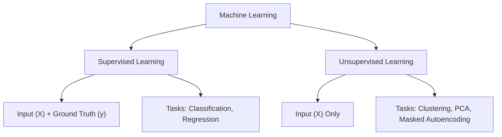

# NotebookLM Study Guide: Chapter 02: The Classical Machine Learning Bridge

**Chapter ID:** `ch02`  
**Part:** Part I: Foundations  
**Target Ingestion:** Google NotebookLM Source (Audio Podcast, Socratic Tutor & Flashcards)

---

## 🎯 Executive Summary & Core Pillars
This chapter covers foundational and production-grade knowledge in modern AI engineering.

### Core Concepts Covered:
- **Supervised/Unsupervised Learning**
- **Loss Curves**
- **Overfitting**
- **Regularization**
- **Cross-Validation**

---

## 📖 In-Depth Concept Breakdown

### 1. Supervised vs. Unsupervised Learning Paradigms

Supervised learning maps inputs X to known labels Y (regression, classification). Unsupervised learning discovers latent structure, groupings, or representations without explicit labels (clustering, dimensionality reduction, self-supervised pre-training).

*Architecture Concept Diagram:*

### 2. Loss Curves, Overfitting & Regularization (L1/L2)

Overfitting occurs when a model memorizes training noise instead of generalizable patterns. Regularization (L1 Lasso for sparsity, L2 Ridge for weight shrinking) penalizes model complexity.

### 3. K-Fold Cross-Validation

K-Fold Cross-Validation partitions data into K subsets, iteratively training on K-1 folds and validating on the remaining fold to assess generalization variance.

---

## 🛠 Hands-On Capstone Lab Blueprint
- **Title:** Build a Regularized Linear Classifier with K-Fold Validation
- **Objective:** Implement an end-to-end binary classifier with L2 weight regularization and measure generalization performance.
- **Implementation Strategy:**
1. Synthesize a 2D linearly separable dataset.
2. Implement a sigmoid activation function.
3. Compute logits, predicted probability, and L2 complexity penalty.

---

## 🎙 Socratic Discussion Questions for NotebookLM Audio Overviews
1. **Trade-off Analysis:** What are the operational latency, memory, and cost implications of the techniques introduced in this chapter?
2. **Production Pitfalls:** Under what conditions do these methods fail (e.g. out-of-memory, prompt injections, catastrophic forgetting, low recall)?
3. **Engineering Synthesis:** How does this chapter connect to downstream systems such as RAG retrieval, agent orchestration, or MCP tooling?

---

## 🗂 Flashcard & Self-Check Review Deck

#### Flashcard 1: What is the primary symptom of an overfitting model during training?
- **Answer:** A) Both training and validation loss increase
- **Explanation:** Overfitting is characterized by diverging loss curves: the model continues to improve on the training data while generalizing poorly to unseen validation data.

#### Flashcard 2: How does L2 regularization (Ridge) penalize model parameters?
- **Answer:** A) By adding the sum of absolute weight values to the loss
- **Explanation:** L2 regularization penalizes large weights by adding the sum of squared weights (lambda * sum(w^2)), shrinking parameter magnitudes.

#### Flashcard 3: Why is K-Fold Cross-Validation preferred over a single train/test split on smaller datasets?
- **Answer:** A) It guarantees 100% test accuracy
- **Explanation:** By rotating the validation set across all K partitions, every data point is used for both training and validation, reducing variance caused by an arbitrary single split.

#### Flashcard 4: Which of the following is an example of Unsupervised Learning?
- **Answer:** A) Predicting house prices given square footage
- **Explanation:** K-Means clustering partitions data into groups based purely on input feature similarity without ground-truth labels, which is unsupervised learning.

