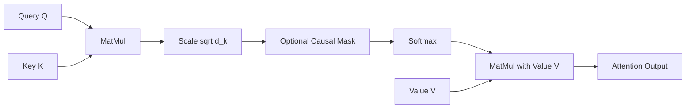

# NotebookLM Study Guide: Chapter 03: Generative AI Foundations

**Chapter ID:** `ch03`  
**Part:** Part II: Core Generative AI & Large Language Models  
**Target Ingestion:** Google NotebookLM Source (Audio Podcast, Socratic Tutor & Flashcards)

---

## 🎯 Executive Summary & Core Pillars
This chapter covers foundational and production-grade knowledge in modern AI engineering.

### Core Concepts Covered:
- **GenAI vs. Discriminative**
- **Neural Nets**
- **Transformers**
- **Self-Attention**
- **Tokens**
- **Embeddings**
- **Foundation Models**
- **Pre-training/Fine-tuning**
- **Diffusion**
- **GANs/VAEs**
- **Multimodal**
- **RLHF**
- **Evals**
- **AI Safety**

---

## 📖 In-Depth Concept Breakdown

### 1. Generative AI vs. Discriminative Models

Discriminative models learn the conditional probability P(Y|X) to classify or predict labels. Generative models learn the joint probability distribution P(X, Y) or data distribution P(X) to sample and generate entirely new synthetic data instances.

*Architecture Concept Diagram:*
```mermaid
graph TD
    subgraph Discriminative
        D_in[Input X] --> D_model[Decision Boundary] --> D_out["P(Y|X): Label Y"]
    end
    subgraph Generative
        G_in[Latent Noise or Prompt] --> G_model[Learned Distribution P(X)] --> G_out["P(X): New Token / Image / Audio"]
    end
```

### 2. Neural Networks, Self-Attention & Transformers

Transformers replaced sequential recurrence with Self-Attention, allowing every token in a sequence to attend to every other token simultaneously. Scaled Dot-Product Attention: Attention(Q, K, V) = softmax(Q K^T / sqrt(d_k)) V.

*Architecture Concept Diagram:*


### 3. The Modern Lifecycle: Pre-training, Fine-Tuning, RLHF & Safety

Building foundation models follows a 4-stage pipeline: (1) Pre-training on trillions of tokens, (2) Supervised Fine-Tuning (SFT) on instructions, (3) Reinforcement Learning from Human Feedback (RLHF / DPO) for alignment, and (4) Evals & Guardrails for AI Safety.


---

## 🛠 Hands-On Capstone Lab Blueprint
- **Title:** Build a Scaled Dot-Product Attention Engine with Causal Masking
- **Objective:** Implement an autoregressive causal attention block where tokens are prevented from attending to future tokens (lookahead mask).
- **Implementation Strategy:**
1. Create a sequence of 3 tokens.
2. Compute attention score matrix Q * K^T.
3. Apply causal mask (-1e9 for future positions) before applying softmax.

---

## 🎙 Socratic Discussion Questions for NotebookLM Audio Overviews
1. **Trade-off Analysis:** What are the operational latency, memory, and cost implications of the techniques introduced in this chapter?
2. **Production Pitfalls:** Under what conditions do these methods fail (e.g. out-of-memory, prompt injections, catastrophic forgetting, low recall)?
3. **Engineering Synthesis:** How does this chapter connect to downstream systems such as RAG retrieval, agent orchestration, or MCP tooling?

---

## 🗂 Flashcard & Self-Check Review Deck

#### Flashcard 1: Why is the dot product scaled by 1/sqrt(d_k) in Scaled Dot-Product Attention?
- **Answer:** A) To prevent gradients from vanishing when dot products grow large in high dimensions
- **Explanation:** For large projection dimensions d_k, dot products grow large in magnitude, pushing softmax into regions with extremely small gradients. Dividing by sqrt(d_k) counteracts this effect.

#### Flashcard 2: What is the primary objective of Reinforcement Learning from Human Feedback (RLHF)?
- **Answer:** A) To teach the model basic grammar from raw unlabelled text
- **Explanation:** RLHF fine-tunes an instruction-tuned model using a reward model trained on human preference rankings to align responses with human values and safety standards.

#### Flashcard 3: In autoregressive decoder-only LLMs (like GPT), what is the purpose of the causal attention mask?
- **Answer:** A) It hides punctuation from the model
- **Explanation:** Causal masking sets attention scores for future positions (j > i) to negative infinity, ensuring that generating token t only depends on tokens at indices <= t.

#### Flashcard 4: What generative paradigm models data generation by learning to iteratively reverse a progressive noise addition process?
- **Answer:** A) Generative Adversarial Networks (GANs)
- **Explanation:** Diffusion models learn the reverse of a Markovian forward process that gradually adds Gaussian noise to data.

