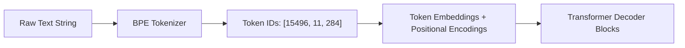

# NotebookLM Study Guide: Chapter 04: Inside Large Language Models

**Chapter ID:** `ch04`  
**Part:** Part II: Core Generative AI & Large Language Models  
**Target Ingestion:** Google NotebookLM Source (Audio Podcast, Socratic Tutor & Flashcards)

---

## 🎯 Executive Summary & Core Pillars
This chapter covers foundational and production-grade knowledge in modern AI engineering.

### Core Concepts Covered:
- **Transformer Architecture**
- **Attention Mechanisms**
- **BPE Tokenization**
- **Positional Encoding**
- **Next-Token Prediction**
- **Instruction Tuning**
- **RLHF/DPO**
- **Context Window**
- **Temp/Top-k/p**
- **Hallucinations**
- **LoRA**
- **Quantization**
- **KV Cache**
- **SLMs**
- **Reasoning Models**

---

## 📖 In-Depth Concept Breakdown

### 1. Tokenization (BPE) & Positional Encoding

Text is broken down into sub-word tokens using Byte-Pair Encoding (BPE). Because Transformers have no inherent recurrent ordering, Positional Encodings (sinusoidal or RoPE) are injected to provide sequence awareness.

*Architecture Concept Diagram:*

### 2. Sampling Strategies: Temperature, Top-k, and Top-p (Nucleus)

During generation, LLMs produce unnormalized logit distributions over vocabulary tokens. Decoding parameters control creativity vs. determinism.

### 3. The KV Cache, LoRA & Quantization (AWQ/GGUF)

In autoregressive inference, caching previous Key and Value matrices (KV Cache) avoids quadratic re-computation. LoRA (Low-Rank Adaptation) decomposes weight updates W = W_0 + B*A with rank r << d, enabling efficient fine-tuning.

---

## 🛠 Hands-On Capstone Lab Blueprint
- **Title:** Build a Complete Autoregressive Sampler & LoRA Decomposition Simulator
- **Objective:** Simulate token-by-token generation with KV caching and calculate parameter efficiency of a LoRA adapter matrix.
- **Implementation Strategy:**
1. Simulate next-token prediction with a KV cache length counter.
2. Calculate parameter count of base weight matrix (d_in x d_out).
3. Calculate parameter count of LoRA matrices A and B where rank r=8.

---

## 🎙 Socratic Discussion Questions for NotebookLM Audio Overviews
1. **Trade-off Analysis:** What are the operational latency, memory, and cost implications of the techniques introduced in this chapter?
2. **Production Pitfalls:** Under what conditions do these methods fail (e.g. out-of-memory, prompt injections, catastrophic forgetting, low recall)?
3. **Engineering Synthesis:** How does this chapter connect to downstream systems such as RAG retrieval, agent orchestration, or MCP tooling?

---

## 🗂 Flashcard & Self-Check Review Deck

#### Flashcard 1: What is the primary purpose of the KV (Key-Value) Cache during LLM inference?
- **Answer:** A) To store the user's password securely
- **Explanation:** Because generation is autoregressive, previous tokens do not change. Caching past Keys and Values reduces per-token computational complexity from O(N^2) to O(N).

#### Flashcard 2: Setting Temperature = 0 in LLM sampling results in which behavior?
- **Answer:** A) Maximum randomness and diversity
- **Explanation:** As temperature approaches zero, probability mass concentrates entirely on the top logit, yielding deterministic greedy decoding.

#### Flashcard 3: In Low-Rank Adaptation (LoRA), what does the rank 'r' represent?
- **Answer:** A) The number of GPUs required for training
- **Explanation:** LoRA approximates weight update delta W with B * A where A in R^(r x d) and B in R^(d x r), where rank r << d determines the capacity of the adapter.

#### Flashcard 4: Which quantization technique compresses 16-bit floating point weights into 4-bit integers while preserving activation accuracy?
- **Answer:** A) BPE Tokenization
- **Explanation:** AWQ (Activation-aware Weight Quantization) and GPTQ quantize model weights to 4 bits while protecting salient weight channels.

