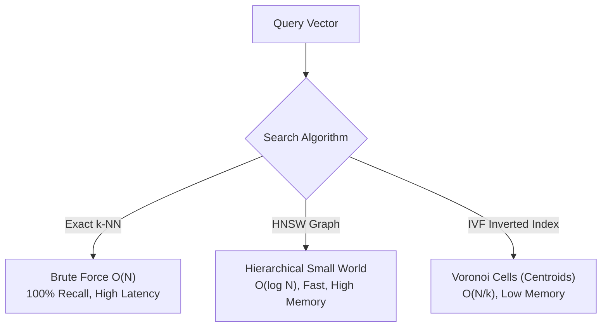

# NotebookLM Study Guide: Chapter 06: Vector Databases & Similarity Search

**Chapter ID:** `ch06`  
**Part:** Part III: Vector Databases, Data & Production RAG  
**Target Ingestion:** Google NotebookLM Source (Audio Podcast, Socratic Tutor & Flashcards)

---

## 🎯 Executive Summary & Core Pillars
This chapter covers foundational and production-grade knowledge in modern AI engineering.

### Core Concepts Covered:
- **Vector DBs**
- **Embeddings**
- **Dimensions**
- **Cosine/Dot Product**
- **k-NN vs. ANN**
- **HNSW & IVF Indexes**
- **Product Quantization**
- **Metadata Filtering**
- **Hybrid Search**
- **Namespaces**
- **Upserts/Deletes**
- **Sharding**
- **Recall vs. Latency**
- **pgvector**
- **Qdrant**
- **Chroma**
- **FAISS**

---

## 📖 In-Depth Concept Breakdown

### 1. Exact k-NN vs. Approximate Nearest Neighbor (ANN)

Exact k-NN compares a query against every vector in the database, yielding 100% recall with O(N * d) linear latency. ANN algorithms (HNSW, IVF) trade a fraction of recall for logarithmic O(log N) retrieval speed.

*Architecture Concept Diagram:*

### 2. HNSW & IVF Index Architectures

HNSW (Hierarchical Navigable Small World) organizes vectors into multi-layer graphs where top layers have long-range skip connections and bottom layers have dense local clustering. IVF (Inverted File) clusters vectors into Voronoi cells and searches only the nearest centroids.

### 3. Hybrid Search & Reciprocal Rank Fusion (RRF)

Dense vector search captures semantic concepts but misses exact keyword matches (IDs, error codes, rare names). Hybrid Search combines BM25 keyword matching with dense ANN search, merging rankings via Reciprocal Rank Fusion (RRF).

---

## 🛠 Hands-On Capstone Lab Blueprint
- **Title:** Build an In-Memory Vector Store with Metadata Filtering & Hybrid RRF
- **Objective:** Build a functional Vector Database class supporting namespaces, upserts, metadata filtering, and hybrid retrieval.
- **Implementation Strategy:**
1. Implement `SimpleVectorStore` with `upsert(id, vector, metadata)`.
2. Implement `query(vector, filter_fn, top_k)`.
3. Execute query filtering for a specific category namespace.

---

## 🎙 Socratic Discussion Questions for NotebookLM Audio Overviews
1. **Trade-off Analysis:** What are the operational latency, memory, and cost implications of the techniques introduced in this chapter?
2. **Production Pitfalls:** Under what conditions do these methods fail (e.g. out-of-memory, prompt injections, catastrophic forgetting, low recall)?
3. **Engineering Synthesis:** How does this chapter connect to downstream systems such as RAG retrieval, agent orchestration, or MCP tooling?

---

## 🗂 Flashcard & Self-Check Review Deck

#### Flashcard 1: What is the primary trade-off when using an Approximate Nearest Neighbor (ANN) index over exact k-NN?
- **Answer:** A) ANN sacrifices a small percentage of recall to achieve orders-of-magnitude faster query latency and scalability
- **Explanation:** Exact k-NN compares against every vector in O(N). ANN algorithms trade a minor fraction of recall for O(log N) speed.

#### Flashcard 2: Why is Hybrid Search (Dense Vectors + Sparse BM25) widely used in enterprise search systems?
- **Answer:** A) Dense vectors excel at semantic similarity while BM25 guarantees precision on exact keyword matches, serial numbers, and proper nouns
- **Explanation:** Hybrid search bridges semantic generalization (dense embeddings) with exact lexical matching (sparse BM25), combined via algorithms like RRF.

#### Flashcard 3: In the HNSW (Hierarchical Navigable Small World) algorithm, what do upper graph layers provide?
- **Answer:** A) High-resolution image thumbnails
- **Explanation:** Similar to a skip-list data structure, upper layers in HNSW feature sparse graphs with long edges for rapid navigation, while lower layers provide dense local clustering.

#### Flashcard 4: In Reciprocal Rank Fusion (RRF), what is the impact of the smoothing parameter k (typically k=60)?
- **Answer:** A) It sets the maximum number of documents returned
- **Explanation:** The smoothing constant k ensures that low rank positions do not excessively dominate the score, producing balanced reciprocal ranking.

