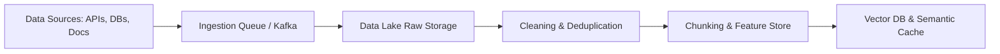

# NotebookLM Study Guide: Chapter 07: Data Engineering for AI Systems

**Chapter ID:** `ch07`  
**Part:** Part III: Vector Databases, Data & Production RAG  
**Target Ingestion:** Google NotebookLM Source (Audio Podcast, Socratic Tutor & Flashcards)

---

## 🎯 Executive Summary & Core Pillars
This chapter covers foundational and production-grade knowledge in modern AI engineering.

### Core Concepts Covered:
- **Data Collection/APIs**
- **ETL/ELT Pipelines**
- **Data Cleaning**
- **SQL/NoSQL**
- **Streaming**
- **Feature Stores**
- **Data Versioning with DVC**

---

## 📖 In-Depth Concept Breakdown

### 1. Modern AI Data Pipelines: ETL vs. ELT

Data is the lifeblood of AI. While traditional ETL transforms data before loading into warehouses, modern AI pipelines often employ ELT or streaming ingestion to preserve raw unstructured data in data lakes for continuous embedding generation and re-indexing.

*Architecture Concept Diagram:*

### 2. Text Cleaning & Normalization for Embeddings

Garbage in, garbage out. Unstructured data often contains HTML tags, whitespace noise, non-printable characters, and boilerplate headers that degrade vector embedding fidelity.

### 3. Feature Stores & Data Versioning (DVC)

Feature Stores provide a centralized repository for both batch and real-time features. Data Version Control (DVC) tracks dataset and model checkpoints using Git-like commit pointers without bloating code repositories.

---

## 🛠 Hands-On Capstone Lab Blueprint
- **Title:** Build an Automated Ingestion, Cleaning & Versioning Pipeline
- **Objective:** Build a complete pipeline that ingests raw documents, deduplicates them, cleans text, extracts metadata features, and registers a dataset manifest.
- **Implementation Strategy:**
1. Ingest a batch of noisy document records.
2. Clean and deduplicate.
3. Compute dataset version hash (manifest signature) and register.

---

## 🎙 Socratic Discussion Questions for NotebookLM Audio Overviews
1. **Trade-off Analysis:** What are the operational latency, memory, and cost implications of the techniques introduced in this chapter?
2. **Production Pitfalls:** Under what conditions do these methods fail (e.g. out-of-memory, prompt injections, catastrophic forgetting, low recall)?
3. **Engineering Synthesis:** How does this chapter connect to downstream systems such as RAG retrieval, agent orchestration, or MCP tooling?

---

## 🗂 Flashcard & Self-Check Review Deck

#### Flashcard 1: What is the primary role of Data Version Control (DVC) in AI engineering?
- **Answer:** A) To replace Git entirely
- **Explanation:** DVC manages large data files outside the Git working tree while tracking version hash pointers in Git, ensuring full reproducibility without repository bloat.

#### Flashcard 2: Why is text cleaning (e.g., stripping HTML tags and control characters) critical before generating embeddings?
- **Answer:** A) HTML tags consume embedding token budget and introduce irrelevant syntactic noise into the semantic vector representation
- **Explanation:** Formatting boilerplate and markup noise consume valuable context tokens and distort vector embeddings away from the underlying semantic meaning.

#### Flashcard 3: What is the key difference between an Online Feature Store and an Offline Feature Store?
- **Answer:** A) Online stores provide low-latency single-record lookups for real-time inference; offline stores provide high-throughput batch queries for training
- **Explanation:** Online stores (often backed by Redis or Cassandra) serve real-time predictions with sub-millisecond latency, while offline stores (Parquet/Snowflake) serve bulk training data.

#### Flashcard 4: In data pipeline design, what does idempotency mean?
- **Answer:** A) A pipeline that runs at 10x speed
- **Explanation:** Idempotent operations can be applied multiple times without changing the result beyond the initial application, critical for fault-tolerant data pipelines.

