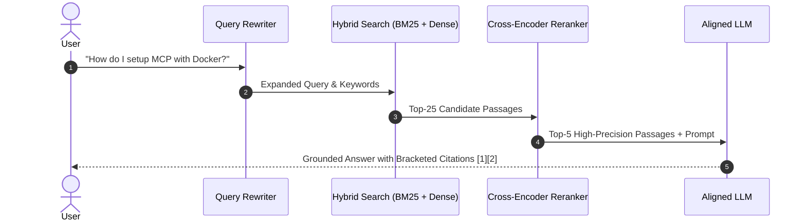

# NotebookLM Study Guide: Chapter 08: Production Retrieval-Augmented Generation (RAG)

**Chapter ID:** `ch08`  
**Part:** Part III: Vector Databases, Data & Production RAG  
**Target Ingestion:** Google NotebookLM Source (Audio Podcast, Socratic Tutor & Flashcards)

---

## 🎯 Executive Summary & Core Pillars
This chapter covers foundational and production-grade knowledge in modern AI engineering.

### Core Concepts Covered:
- **Why RAG**
- **Architecture**
- **Document Loading**
- **Chunking Strategies**
- **Embedding Models**
- **Indexing**
- **Top-k**
- **Hybrid BM25 Search**
- **Cross-Encoder Re-ranking**
- **Query Rewriting**
- **Prompt Augmentation**
- **Context Mgmt**
- **Citations/Grounding**
- **Multi-hop RAG**
- **GraphRAG**
- **Agentic RAG**
- **RAG Evals**

---

## 📖 In-Depth Concept Breakdown

### 1. Why RAG & Production System Architecture

LLMs suffer from knowledge cutoffs, domain gaps, and hallucinations. Retrieval-Augmented Generation grounds generations in fresh, proprietary external knowledge without expensive model re-training.

*Architecture Concept Diagram:*

### 2. Chunking Strategies: Fixed, Sliding Window & Semantic

Chunking splits documents into digestible passages. Fixed-size chunking can split sentences mid-thought. Sliding window adds overlap to preserve boundary context. Semantic chunking splits based on semantic shifts between sentences.

### 3. Query Rewriting & Cross-Encoder Re-ranking

Raw user queries are often ambiguous or underspecified. Query rewriting expands acronyms and generates hypothetical document embeddings (HyDE). Cross-encoders then perform full cross-attention over (query, passage) pairs to re-order the top candidates.

---

## 🛠 Hands-On Capstone Lab Blueprint
- **Title:** Build an Advanced RAG Pipeline with Semantic Chunking, Reranking & Citations
- **Objective:** Build a modular RAG pipeline that processes documents, executes retrieval, reranks candidates, and constructs a grounded response with source citations.
- **Implementation Strategy:**
1. Ingest document and chunk into passages.
2. Execute retrieval and reranking for a query.
3. Format context with `[Doc 1]`, `[Doc 2]` citations into the final generation prompt.

---

## 🎙 Socratic Discussion Questions for NotebookLM Audio Overviews
1. **Trade-off Analysis:** What are the operational latency, memory, and cost implications of the techniques introduced in this chapter?
2. **Production Pitfalls:** Under what conditions do these methods fail (e.g. out-of-memory, prompt injections, catastrophic forgetting, low recall)?
3. **Engineering Synthesis:** How does this chapter connect to downstream systems such as RAG retrieval, agent orchestration, or MCP tooling?

---

## 🗂 Flashcard & Self-Check Review Deck

#### Flashcard 1: What is the primary advantage of a Cross-Encoder reranker compared to bi-encoder vector similarity?
- **Answer:** A) Cross-encoders are 10,000x faster than bi-encoders
- **Explanation:** Bi-encoders encode queries and passages independently into single vectors. Cross-encoders encode them jointly, capturing subtle token interactions at the cost of higher latency.

#### Flashcard 2: In RAG evaluations (e.g. Ragas), what does 'Faithfulness' measure?
- **Answer:** A) How quickly the model responds
- **Explanation:** Faithfulness evaluates whether the generated output is factually consistent with the retrieved context (i.e. zero hallucinations beyond provided text).

#### Flashcard 3: What is 'GraphRAG'?
- **Answer:** A) RAG using only pie charts
- **Explanation:** GraphRAG extracts knowledge graphs (communities of entities and relationships) to summarize themes across large corpora that standard vector chunks miss.

#### Flashcard 4: Why is sliding-window chunking with overlap preferred over strict non-overlapping chunking?
- **Answer:** A) It ensures that semantic meaning and entity relationships that span across chunk boundaries are not severed
- **Explanation:** Overlapping chunk boundaries prevent splitting critical statements or sentence transitions mid-thought, preserving contextual coherence.

