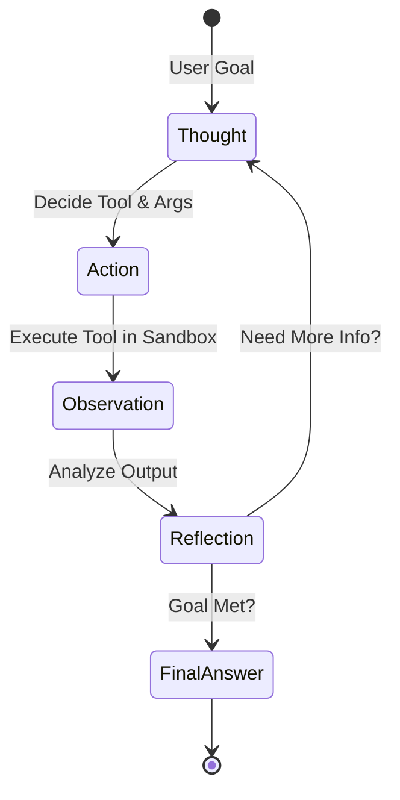
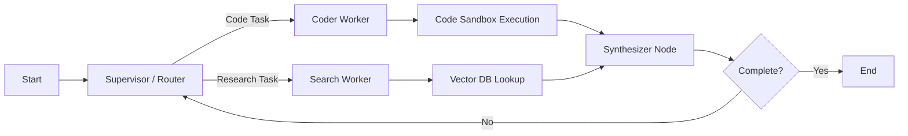

# NotebookLM Study Guide: Chapter 09: Autonomous AI Agents

**Chapter ID:** `ch09`  
**Part:** Part IV: Autonomous Agents, MCP & Production MLOps  
**Target Ingestion:** Google NotebookLM Source (Audio Podcast, Socratic Tutor & Flashcards)

---

## 🎯 Executive Summary & Core Pillars
This chapter covers foundational and production-grade knowledge in modern AI engineering.

### Core Concepts Covered:
- **Agent Anatomy**
- **Think→Act→Observe**
- **ReAct**
- **Tool/Function Calling**
- **Planning/Decomposition**
- **Short/Long-Term Memory**
- **Reflection/Self-Critique**
- **Multi-Agent Systems**
- **Orchestrator-Worker**
- **Routing**
- **LangGraph Frameworks**
- **Browser/Computer Use**
- **Code Sandboxes**
- **Human-in-the-Loop**
- **Checkpointing**
- **Cost/Latency Control**

---

## 📖 In-Depth Concept Breakdown

### 1. Agent Anatomy & The ReAct Loop

An AI Agent is an LLM equipped with tools, memory, and a reasoning control loop. The ReAct pattern alternates between Thought (reasoning), Action (tool call), and Observation (tool result) until the objective is accomplished.

*Architecture Concept Diagram:*

### 2. Agent State Machines & LangGraph Architecture

Production agents avoid fragile infinite loops by modeling workflows as cyclical state graphs (e.g. LangGraph). State transitions are governed by typed state objects, conditional routing edges, and checkpointed memory.

*Architecture Concept Diagram:*

### 3. Human-in-the-Loop (HITL) & Sandboxed Tool Execution

Autonomous agents must operate safely within permission boundaries. Dangerous actions (database writes, payments, file deletions) require Human-in-the-Loop authorization checkpoints.

---

## 🛠 Hands-On Capstone Lab Blueprint
- **Title:** Build an Orchestrator-Worker Multi-Agent System with Checkpointing
- **Objective:** Build a multi-agent system where an Orchestrator decomposes a user request into sub-tasks, delegates to specialized Worker agents, and aggregates results.
- **Implementation Strategy:**
1. Define Orchestrator agent that splits task into sub-tasks.
2. Define Worker agents (ResearchWorker, CodeWorker).
3. Execute workflow and record full execution trace.

---

## 🎙 Socratic Discussion Questions for NotebookLM Audio Overviews
1. **Trade-off Analysis:** What are the operational latency, memory, and cost implications of the techniques introduced in this chapter?
2. **Production Pitfalls:** Under what conditions do these methods fail (e.g. out-of-memory, prompt injections, catastrophic forgetting, low recall)?
3. **Engineering Synthesis:** How does this chapter connect to downstream systems such as RAG retrieval, agent orchestration, or MCP tooling?

---

## 🗂 Flashcard & Self-Check Review Deck

#### Flashcard 1: What does the ReAct framework stand for in autonomous agents?
- **Answer:** A) React.js Web Framework
- **Explanation:** ReAct combines Reasoning (generating thought traces) and Acting (calling external tools), creating an iterative problem-solving loop.

#### Flashcard 2: Why are state machine frameworks like LangGraph preferred over simple while-loops for production agents?
- **Answer:** A) They provide cyclic graphs, deterministic checkpointing, branch routing, and human-in-the-loop interruption
- **Explanation:** Production agents need explicit state control, persistent checkpoints to resume interrupted runs, and conditional branching, which graph abstractions provide.

#### Flashcard 3: What is the primary function of Human-in-the-Loop (HITL) design in AI agent systems?
- **Answer:** A) To force humans to write all code
- **Explanation:** HITL establishes governance guardrails, pausing the agent's autonomous loop to require explicit human sign-off on sensitive operations.

#### Flashcard 4: In a Multi-Agent system, what is the role of an Orchestrator/Supervisor agent?
- **Answer:** A) To execute all tools directly without delegation
- **Explanation:** The Orchestrator maintains high-level context, decomposes the master plan into granular subtasks, and routes them to domain-specific worker agents.

