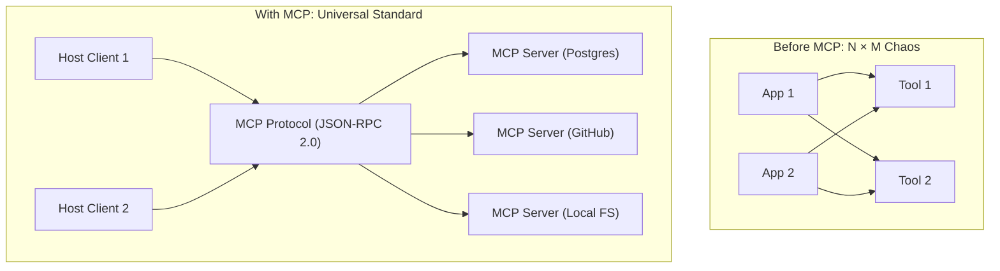
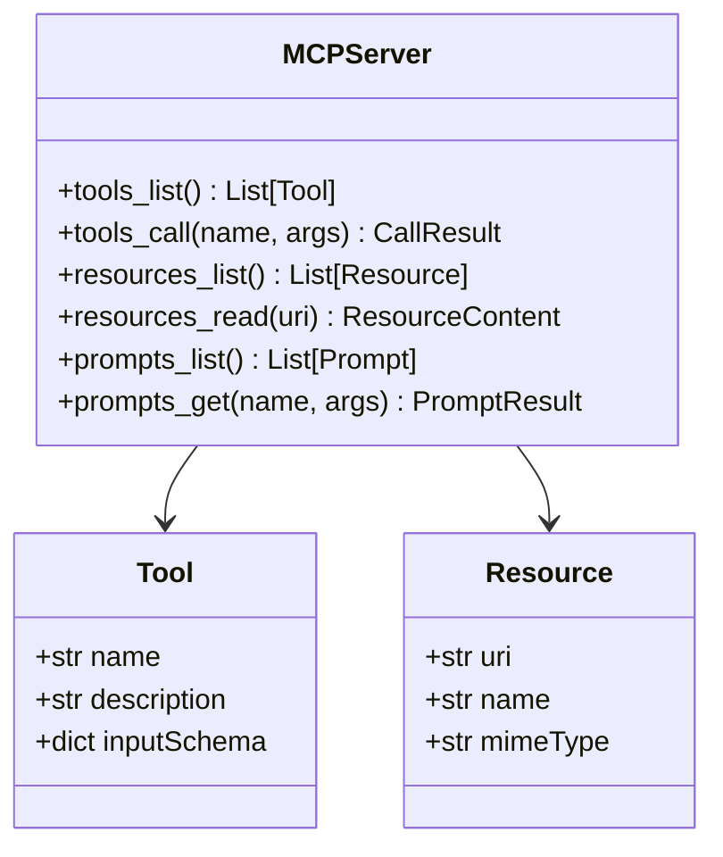

# NotebookLM Study Guide: Chapter 10: Model Context Protocol (MCP)

**Chapter ID:** `ch10`  
**Part:** Part IV: Autonomous Agents, MCP & Production MLOps  
**Target Ingestion:** Google NotebookLM Source (Audio Podcast, Socratic Tutor & Flashcards)

---

## 🎯 Executive Summary & Core Pillars
This chapter covers foundational and production-grade knowledge in modern AI engineering.

### Core Concepts Covered:
- **What is MCP**
- **N×M Problem**
- **Hosts/Clients/Servers**
- **JSON-RPC**
- **Tools**
- **Resources**
- **Prompts**
- **Sampling**
- **Capability Negotiation**
- **stdio vs. Streamable HTTP**
- **Lifecycle**
- **Tool Schemas**
- **OAuth**
- **Building MCP Servers**
- **Connecting IDEs/Apps**
- **Local vs. Remote**
- **Prompt Injection**
- **Permissions**
- **MCP Inspector**

---

## 📖 In-Depth Concept Breakdown

### 1. What is MCP & Solving the N×M Integration Problem

Before MCP, connecting N AI applications (Claude Desktop, Antigravity, Cursor, LangChain) to M data sources (GitHub, Slack, Postgres, local files) required N×M bespoke custom plugins. MCP standardizes this into an open JSON-RPC 2.0 protocol: any Host client can connect to any MCP Server.

*Architecture Concept Diagram:*

### 2. The Three Core Primitives: Tools, Resources, and Prompts

MCP defines three standard capabilities: (1) Tools — executable functions with JSON schemas that models can invoke; (2) Resources — file-like data and schemas that clients can read; (3) Prompts — pre-defined prompt templates provided by servers.

*Architecture Concept Diagram:*

### 3. MCP Transports: stdio vs. Streamable HTTP (SSE)

MCP supports two primary transport mechanisms: (1) stdio — standard input/output pipes for fast, secure local process communication without opening network ports; (2) Streamable HTTP / Server-Sent Events (SSE) for remote enterprise servers.

---

## 🛠 Hands-On Capstone Lab Blueprint
- **Title:** Build a Fully Compliant In-Memory MCP Server with Tool & Resource Handling
- **Objective:** Build an MCP Server class supporting `tools/list`, `tools/call`, and `resources/read` JSON-RPC dispatching with input validation.
- **Implementation Strategy:**
1. Implement JSON-RPC router handling `tools/list` and `tools/call`.
2. Expose a tool `get_system_metrics`.
3. Execute and test with valid and invalid calls.

---

## 🎙 Socratic Discussion Questions for NotebookLM Audio Overviews
1. **Trade-off Analysis:** What are the operational latency, memory, and cost implications of the techniques introduced in this chapter?
2. **Production Pitfalls:** Under what conditions do these methods fail (e.g. out-of-memory, prompt injections, catastrophic forgetting, low recall)?
3. **Engineering Synthesis:** How does this chapter connect to downstream systems such as RAG retrieval, agent orchestration, or MCP tooling?

---

## 🗂 Flashcard & Self-Check Review Deck

#### Flashcard 1: What is the primary architectural problem that the Model Context Protocol (MCP) eliminates?
- **Answer:** A) The N×M fragmentation problem where every client required custom connectors for every data source
- **Explanation:** MCP standardizes client-server protocol over JSON-RPC, transforming N×M custom integrations into N clients and M servers communicating through one standard.

#### Flashcard 2: Which protocol standard forms the underlying communication format of MCP messages?
- **Answer:** A) GraphQL
- **Explanation:** MCP strictly leverages JSON-RPC 2.0 specifying requests, responses, notifications, error codes, and unique message IDs.

#### Flashcard 3: What are the three core server primitives exposed by an MCP Server?
- **Answer:** A) Headers, Cookies, and Sessions
- **Explanation:** MCP servers expose Tools (executable actions), Resources (context data/content), and Prompts (reusable parameterized prompt templates).

#### Flashcard 4: Why is the `stdio` transport advantageous for local desktop AI tools (like Claude Desktop or Antigravity)?
- **Answer:** A) It transmits data faster than light
- **Explanation:** stdio processes are launched as child processes communicating over stdin/stdout, isolating them behind host operating system permissions without listening sockets.

