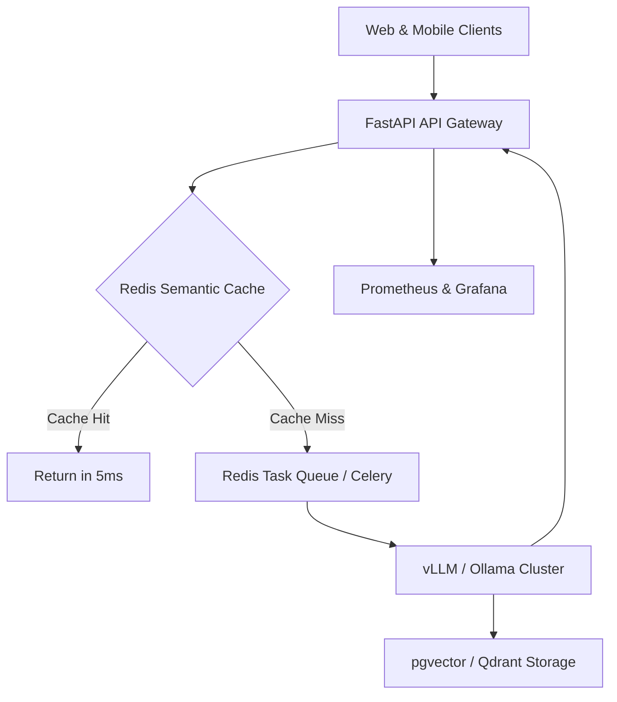

# NotebookLM Study Guide: Chapter 11: Production Systems & MLOps for AI

**Chapter ID:** `ch11`  
**Part:** Part IV: Autonomous Agents, MCP & Production MLOps  
**Target Ingestion:** Google NotebookLM Source (Audio Podcast, Socratic Tutor & Flashcards)

---

## 🎯 Executive Summary & Core Pillars
This chapter covers foundational and production-grade knowledge in modern AI engineering.

### Core Concepts Covered:
- **System Design**
- **Microservices**
- **Redis Caching**
- **Celery/Queues**
- **Model Serving with vLLM/FastAPI**
- **Docker/Compose**
- **GitHub Actions CI/CD**
- **Prometheus/Grafana Monitoring**

---

## 📖 In-Depth Concept Breakdown

### 1. Production AI System Architecture & Microservices

Production AI infrastructure decouples high-throughput API gateways from compute-heavy model serving engines (vLLM, Ollama, Triton) using asynchronous queues (Redis/Celery) and semantic caching layers.

*Architecture Concept Diagram:*

### 2. Exact & Semantic Caching with Redis

Exact caching stores responses keyed by prompt MD5 hash. Semantic caching embeds the incoming query and performs vector similarity against cached queries, returning the cached response if similarity exceeds threshold (e.g. 0.96), saving 90%+ latency and cost.

### 3. High-Throughput Serving & Streaming with FastAPI

LLM generation is slow (seconds to minutes). Real-time UX demands Server-Sent Events (SSE) or WebSockets so users see tokens stream immediately as they are sampled.

---

## 🛠 Hands-On Capstone Lab Blueprint
- **Title:** Build a Resilient API Gateway with Rate Limiting & Prometheus Metrics
- **Objective:** Build an API Gateway middleware class that enforces token bucket rate limiting and tracks Prometheus metrics (request counts, latency histograms).
- **Implementation Strategy:**
1. Implement metrics simulator.
2. Record request latency and status codes.
3. Verify telemetry summary metrics.

---

## 🎙 Socratic Discussion Questions for NotebookLM Audio Overviews
1. **Trade-off Analysis:** What are the operational latency, memory, and cost implications of the techniques introduced in this chapter?
2. **Production Pitfalls:** Under what conditions do these methods fail (e.g. out-of-memory, prompt injections, catastrophic forgetting, low recall)?
3. **Engineering Synthesis:** How does this chapter connect to downstream systems such as RAG retrieval, agent orchestration, or MCP tooling?

---

## 🗂 Flashcard & Self-Check Review Deck

#### Flashcard 1: What is the primary benefit of Semantic Caching over standard Exact-Match Caching for LLMs?
- **Answer:** A) It converts text into MP3 audio
- **Explanation:** Users ask identical questions with slight variations in wording. Semantic caching computes vector similarity against cached queries, serving answers instantly when intent matches.

#### Flashcard 2: Why is Server-Sent Events (SSE) streaming essential in generative AI web interfaces?
- **Answer:** A) It drastically reduces Time-To-First-Token (TTFT) perception by rendering tokens to the user as they are generated
- **Explanation:** Without streaming, users must wait for the entire multi-second response to complete. Streaming renders partial tokens immediately, maximizing user perceived responsiveness.

#### Flashcard 3: What is the role of Prometheus in an MLOps monitoring stack?
- **Answer:** A) To generate synthetic training data
- **Explanation:** Prometheus is a time-series monitoring system that scrapes metrics endpoints at regular intervals and enables alerting based on SLO thresholds.

#### Flashcard 4: What serving optimization is used by engines like vLLM to dramatically increase throughput?
- **Answer:** A) PagedAttention: managing KV cache memory like OS virtual memory paging to eliminate fragmentation
- **Explanation:** PagedAttention treats the KV cache as non-contiguous memory pages (inspired by OS virtual memory), reducing memory waste to near zero and boosting batch throughput 2-4x.

