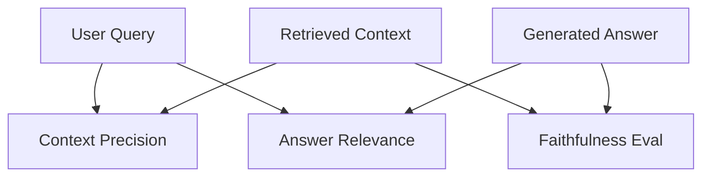

# NotebookLM Study Guide: Chapter 12: Evals, Observability & AI Safety

**Chapter ID:** `ch12`  
**Part:** Part IV: Autonomous Agents, MCP & Production MLOps  
**Target Ingestion:** Google NotebookLM Source (Audio Podcast, Socratic Tutor & Flashcards)

---

## 🎯 Executive Summary & Core Pillars
This chapter covers foundational and production-grade knowledge in modern AI engineering.

### Core Concepts Covered:
- **Ragas & DeepEval**
- **Prompt A/B Testing**
- **Hallucination Detection**
- **OpenTelemetry Traces/Logs/Metrics**
- **Cost & Latency Optimization**
- **GDPR/HIPAA Privacy**
- **AI Alignment/Fairness**
- **Product UX**

---

## 📖 In-Depth Concept Breakdown

### 1. Continuous Evals & The RAG Triad (Ragas / DeepEval)

You cannot improve what you cannot measure. Modern AI evaluations test the RAG Triad: (1) Context Precision (did we retrieve relevant passages?), (2) Faithfulness (is the answer grounded in context?), and (3) Answer Relevance (did we address the user's question?).

*Architecture Concept Diagram:*

### 2. OpenTelemetry Tracing for Multi-Step AI Pipelines

Complex agent and RAG workflows involve nested function calls. OpenTelemetry distributed tracing models these interactions as Spans with timestamps, latency, token usage, and error events.

### 3. AI Privacy, GDPR/HIPAA Redaction & Bias Guardrails

Enterprise AI must comply with privacy mandates (GDPR, HIPAA, SOC 2). Personally Identifiable Information (PII) such as SSNs, credit cards, emails, and medical identifiers must be scrubbed before sending prompts to external models.

---

## 🛠 Hands-On Capstone Lab Blueprint
- **Title:** Build a Unified Evaluation, Tracing & Privacy Guardrail Harness
- **Objective:** Build a safety and observability wrapper that redacts incoming PII, logs an OpenTelemetry span, and executes automated faithfulness evaluation on the output.
- **Implementation Strategy:**
1. Sanitize prompt text with PII redaction.
2. Trace execution time and token metrics.
3. Calculate Faithfulness score of the generated text against context.

---

## 🎙 Socratic Discussion Questions for NotebookLM Audio Overviews
1. **Trade-off Analysis:** What are the operational latency, memory, and cost implications of the techniques introduced in this chapter?
2. **Production Pitfalls:** Under what conditions do these methods fail (e.g. out-of-memory, prompt injections, catastrophic forgetting, low recall)?
3. **Engineering Synthesis:** How does this chapter connect to downstream systems such as RAG retrieval, agent orchestration, or MCP tooling?

---

## 🗂 Flashcard & Self-Check Review Deck

#### Flashcard 1: In the RAG Triad evaluation framework, what is evaluated by 'Context Precision'?
- **Answer:** A) How fast the vector database queries run
- **Explanation:** Context Precision measures the signal-to-noise ratio of the retrieval stage: whether the retrieved documents directly contribute to answering the query without noise.

#### Flashcard 2: What is the primary role of OpenTelemetry in generative AI observability?
- **Answer:** A) To generate synthetic training data
- **Explanation:** OpenTelemetry provides an open, vendor-neutral standard for traces, metrics, and logs, making multi-step LLM chains and agent tool invocations debuggable in production.

#### Flashcard 3: Under GDPR and HIPAA, what must occur before transmitting proprietary user records to third-party model APIs?
- **Answer:** A) The text must be translated into French
- **Explanation:** Regulatory frameworks mandate strict data protection; identifiable personal and medical information must be redacted or pseudonymized before external transmission.

#### Flashcard 4: What does a Hallucination Detection guardrail primarily check for?
- **Answer:** A) Spelling errors and grammar mistakes
- **Explanation:** Hallucination detectors test for unsubstantiated claims in the model's response that lack grounding in verified source evidence.

